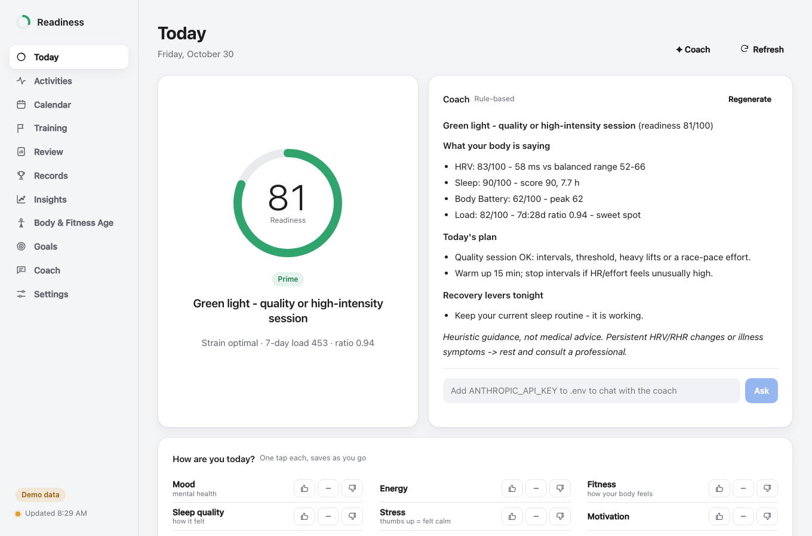
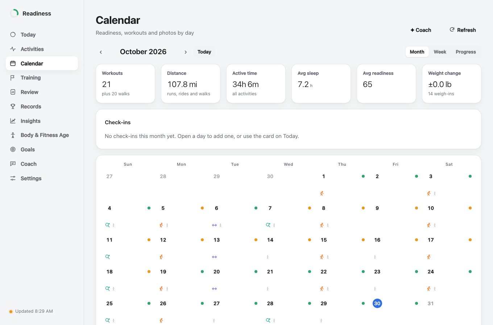

# Readiness Coach for Garmin

A local, single-user dashboard and training coach for **your own** Garmin data. It reads your
recovery and training numbers through Garmin's **Personal API** (HRV, sleep, Body Battery, resting
heart rate, stress, steps, activities), turns them into a daily readiness score with a plain-language
plan, and adds training plans, structured workouts, strength tracking, personal records, weekly
reviews, check-ins, progress photos and BodySpec DEXA scan tracking. Everything runs and is stored on
your computer. An optional Claude-powered coach writes the explanations; without it, built-in rules do.

> **Unofficial.** This project is not affiliated with, endorsed by, sponsored by or supported by
> Garmin Ltd. or its subsidiaries, Anthropic PBC, or BodySpec, Inc. Garmin, Garmin Connect and Body
> Battery are trademarks of Garmin Ltd. or its subsidiaries; Claude and Anthropic are trademarks of
> Anthropic PBC; BodySpec is a trademark of BodySpec, Inc. All other trademarks belong to their
> owners. "for Garmin" only says which data it works with. No Garmin logo or artwork is used.

> **Not medical advice.** Readiness scores, plans and coach messages are general fitness
> information, not medical advice, diagnosis or treatment. DEXA results here are not a bone density
> exam. Talk to a qualified professional about symptoms, injuries or health decisions.

> **Personal use only.** Garmin's Personal API gives each person programmatic access to *their own*
> data with a key they create themselves. Garmin describes it as "not intended for commercial
> applications serving multiple end users". Run this app for yourself, on your own computer, with
> your own key. Don't turn it into a hosted or multi-user service, don't share your key, and don't
> use it to collect other people's data. For anything multi-user, see Garmin's
> [Connect Developer Program](https://developer.garmin.com/gc-developer-program/).




*Screenshots use the built-in synthetic demo data (no Garmin account, no real person).*

## Contents

- [Install](#install)
- [Getting a Garmin Personal API key](#getting-a-garmin-personal-api-key)
- [Optional: Claude coach (Anthropic API key)](#optional-claude-coach-anthropic-api-key)
- [Privacy: what stays on your machine and what leaves it](#privacy-what-stays-on-your-machine-and-what-leaves-it)
- [Security of the local server](#security-of-the-local-server)
- [macOS notes](#macos-notes)
- [Troubleshooting](#troubleshooting)
- [Tests](#tests)
- [Project layout](#project-layout)
- [License](#license)

## Install

You need Python 3 (developed and tested with Python 3.14 on macOS) and git.

```bash
git clone <this repository> readiness-coach
cd readiness-coach
python3 -m venv .venv
.venv/bin/pip install -r requirements.txt
cp .env.example .env          # then edit .env; every value is optional
.venv/bin/python run.py       # opens a desktop window (pywebview)
```

- `.venv/bin/python run.py --browser` opens your browser instead of a desktop window.
- With no `GARMIN_API_KEY` the app runs in **demo mode** on synthetic data, so you can try it first.
  `GARMIN_DEMO=1` forces demo mode even when a key is set.
- The server listens on `http://127.0.0.1:8765` only. Set `COACH_PORT` in `.env` to change the port.

## Getting a Garmin Personal API key

1. Sign in to Garmin Connect on the web and open the **Personal API Key** page:
   <https://connect.garmin.com/app/settings/personalApiToken>
   (Garmin's own instructions: [Personal API FAQ](https://developer.garmin.com/gc-developer-program/personal/personal-faq/)).
2. Select **Create Key**, read and accept Garmin's terms, choose how long the key lasts
   (Garmin offers 30, 90 or 180 days, or one year) and create it.
3. Copy the key straight into `.env` as `GARMIN_API_KEY=...`. **Garmin shows it only once.** If you
   lose it, delete it on that page and create a new one. Garmin emails you before it expires.
4. Restart the app. The sidebar badge changes from "Demo data" to your data.

The app exchanges the key for a short-lived access token (Garmin's documented flow) and only *reads*
data. Deleting the key on Garmin's page revokes access at once. Keep the key in `.env`, which is
git-ignored. Don't put it in screenshots, issues or chat messages.

## Optional: Claude coach (Anthropic API key)

Without a key, the coach uses deterministic rules and nothing is sent to an AI service. To get the
written briefings, chat and plan explanations:

1. Create a key in the [Anthropic Console](https://console.anthropic.com/) (API usage is billed by
   Anthropic to your account).
2. Add `ANTHROPIC_API_KEY=...` to `.env` and restart.
3. Optionally choose models in **Settings > Coach**, or with `COACH_MODEL_DEEP` / `COACH_MODEL_FAST`.
   **Settings > System status** shows the calls made and their estimated cost.

## Privacy: what stays on your machine and what leaves it

**Stays local.** Your goals, settings, check-ins, notes, plans, workouts, strength log, records,
progress photos, DEXA PDFs and everything derived from them live in `.data/` (SQLite plus files).
Cached Garmin responses live in `.cache/` and logs in `logs/`. All three are git-ignored, and
`tests/test_repo_hygiene.py` checks every write location stays ignored. Photos have their EXIF/GPS
metadata stripped when they're saved. The DEXA parser drops the client name and birth date and keeps
only sex and age. **Settings > Your data** can export everything as a zip or delete it.

**Leaves your machine, and only when you use the feature:**

| Destination | When | What is sent |
|---|---|---|
| Garmin (`personal.connectapi.garmin.com`) | Garmin key set | Your key (exchanged for a token) and read requests for your own data |
| Anthropic (`api.anthropic.com`) | `ANTHROPIC_API_KEY` set and you use the coach | Derived numbers and summaries. `privacy.py` drops names, emails, birth dates, GPS/location fields, photos, file paths, free-text notes and Garmin IDs, and redacts keys/tokens. Check-in text is shared only if you turn that on in Settings |
| Open-Meteo (`open-meteo.com`) | You enter a city for weather context | The city name (geocoding), then coordinates rounded to 0.1° |
| Your calendar host | `COACH_CALENDAR_ICS` set | A request for that ICS URL. Only busy start/end times are kept |
| Intervals.icu | `INTERVALS_API_KEY` set and you send a workout | That workout |
| jsDelivr CDN | Every page load | Requests for Chart.js and Leaflet (pinned versions with SRI hashes) |
| CARTO / OpenStreetMap tiles | You open an activity map | Requests for map tiles, which show the tile host roughly where that map is |

There is no telemetry, analytics or crash reporting. Logs are written locally, with keys and tokens
redacted.

## Security of the local server

- Binds to `127.0.0.1` only.
- **Host header validation:** only `127.0.0.1`, `localhost` or `[::1]` on the configured port is
  answered. This blocks DNS-rebinding attacks from web pages.
- **Origin/Referer checks:** every request other than GET/HEAD must come from the app's own page.
  Other websites open in your browser can't change your data.
- **No CORS headers**, so other sites can't read responses either.
- `/api/raw` (a raw Garmin response viewer for debugging) is **off** unless `COACH_DEBUG_RAW=1`, and
  then serves only paths under the Garmin services the app itself uses.

See [SECURITY.md](SECURITY.md) to report a vulnerability.

## macOS notes

- `macos/build_app.sh` builds **Readiness Coach for Garmin.app** into `~/Applications` (another
  folder: `macos/build_app.sh /path`). It needs the Xcode Command Line Tools
  (`xcode-select --install`) and an existing `.venv` with the requirements installed.
- The bundle embeds `.venv`'s Python and has the project path baked in. **Rebuild after moving the
  project folder or recreating `.venv`.**
- It's ad-hoc signed, not notarized. On first launch, if macOS blocks it, Control-click the app and
  choose **Open**, or allow it in **System Settings > Privacy & Security**.
- Only one copy runs at a time (`logs/app.lock`). The Dock app writes its output to
  `logs/readiness_coach.log`.
- HEIC photos from an iPhone are supported through `pillow-heif`.
- Copying workouts to a watch over USB looks for a Garmin device mounted under `/Volumes`.

## Troubleshooting

| Symptom | What to try |
|---|---|
| Sidebar still says "Demo data" | `GARMIN_API_KEY` is empty or `GARMIN_DEMO=1` is set in `.env`. Restart after editing `.env`. |
| "401" / "invalid key" from Garmin | The key expired or was deleted. Create a new one on the Personal API Key page. |
| "429" or slow first sync | Garmin is rate-limiting. The first history sync is large; wait and press Refresh later. |
| "Port 8765 is in use" or "already running elsewhere" | Another copy is running, or set `COACH_PORT=8766` in `.env`. |
| A 403 "only answers requests addressed to 127.0.0.1" | Open `http://127.0.0.1:<port>`, not your machine's network name or IP. |
| A 403 "only accepted from the app's own page" | A browser extension or proxy stripped the `Origin` header, or the request came from another site. |
| Charts or maps don't render | The page couldn't load Chart.js/Leaflet from jsDelivr (offline, blocked, or a file failed its SRI check). |
| `SSL: CERTIFICATE_VERIFY_FAILED` | python.org builds on macOS: run `Install Certificates.command` in your Python folder. |
| DEXA report not recognized | Only BodySpec PDFs with a text layer are supported (not scans or photos). |
| The macOS app won't start after moving the folder | Run `macos/build_app.sh` again. |
| Anything else | **Settings > System status** has per-feed status and a copyable diagnostics report. Details are in `logs/readiness_coach.log`. **Redact before sharing either.** |

## Tests

```bash
.venv/bin/python -m unittest discover -s tests -v
```

The tests use throwaway data folders and never call Garmin or Anthropic. The DEXA parser tests run
on `tests/fixtures/synthetic_bodyspec.pdf`, an invented "Test Person" report generated by
`tests/fixtures/synthetic_dexa.py`. To check your own BodySpec PDFs, put them in `samples/`
(git-ignored). An extra test then checks their structure and internal consistency without recording
any values.

## Project layout

```
run.py                 start the server and open the window (or --browser)
server.py              FastAPI app: routes, local-only guard (Host/Origin), caching
garmin_client.py       Garmin Personal API client (token exchange, reads, normalizing)
store.py               SQLite store in .data/coach.db
coach.py ai.py         rule-based coach + the only module that talks to Anthropic
coach_tools.py coach_actions.py coach_schemas.py coach_trace.py proactive.py
                       the coach's read-only tools, proposals, answer checks, traceability, notices
privacy.py             the filter everything passes through before it can reach Claude
activity.py body.py calendar_data.py charts.py correlate.py review.py records.py records_sync.py
                       dashboard features: activities, body, calendar, charts, insights, review, records
goals.py plans.py workouts.py workout_export.py intervals.py strength.py strength_lib.py
                       goals, event plans, structured workouts, FIT export, Intervals.icu, strength
checkins.py photos.py  daily check-ins; progress photos (metadata stripped)
dexa.py dexa_parse.py  BodySpec DEXA import, parsing and analysis
context_ext.py         optional weather (Open-Meteo) and calendar (ICS) context
health.py applog.py    status page and diagnostics; logging with secrets redacted
units.py demo.py demo_history.py
static/index.html      the whole front end (Chart.js and Leaflet from jsDelivr, with SRI)
macos/                 .app launcher (C), single-instance wrapper, icon drawing, build script
tests/                 unittest suite; tests/fixtures/ holds the synthetic DEXA report
docs/screenshots/      README images (demo data)
```

## License

[MIT](LICENSE). Third-party components and their licenses, map data attribution and tile terms are
listed in [THIRD_PARTY_NOTICES.md](THIRD_PARTY_NOTICES.md).
